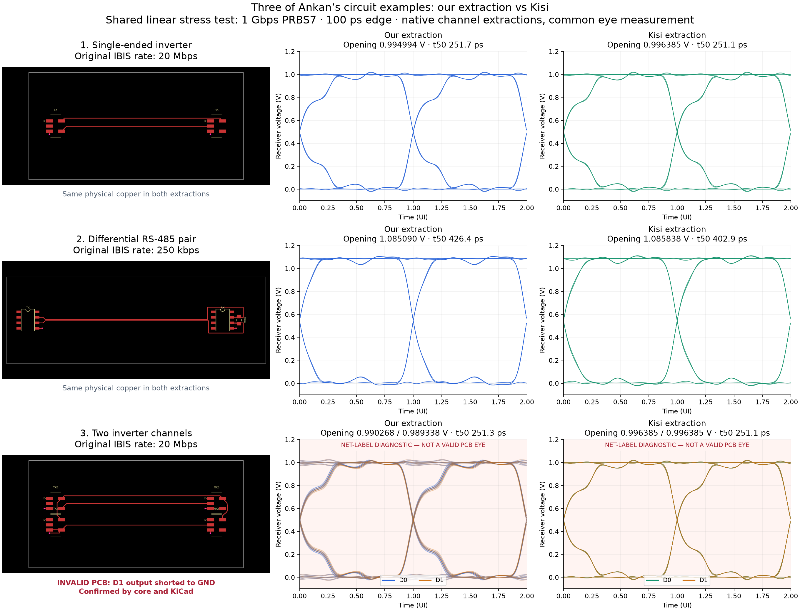

# Kisi signal-integrity benchmark

Three circuit examples from [Ankan Roy’s (`0hmX`) PR #87](https://github.com/tscircuit/signal-integrity-pipeline/pull/87), compared between **tscircuit’s routed signal-integrity pipeline** and **Kisi 0.3.3**. Recorded on 18 November 2026.

The two tools independently extract the channel. A common Python implementation applies the loads, synthesizes the eye, and measures both results. This checks extraction agreement; it does not independently validate that shared measurement code or establish physical accuracy.

## Results

| Current rendered example | Pipeline eye opening | Kisi eye opening | Pipeline / Kisi step delay | Finding |
| --- | ---: | ---: | ---: | --- |
| Single-ended inverter | 0.994994 V | 0.996385 V | 251.74 / 251.14 ps | Close agreement |
| Differential RS-485 pair | 1.085090 V | 1.085838 V | 426.43 / 402.93 ps | 23.50 ps timing gap; SPICE export issue |
| Two inverter channels (D0 / D1) | 0.990268 / 0.989338 V | 0.996385 / 0.996385 V | 251.28 / 251.14 ps (D0) | **Invalid PCB: output-to-GND short** |

**The third row is a net-label diagnostic, not a valid physical-board eye.** Core reports an accidental copper contact and KiCad independently reports two shorting contacts. Both extractors still produce plausible eyes. The original geometry is retained so this failure remains visible.

**Kisi’s differential SPICE export fails its own strict check:** maximum step error is 5.18% for ladder and 5.21% for compact, above the validator’s 5% limit. The comparison above uses Kisi’s native Touchstone channel, not those approximations. The 23.50 ps native-channel timing gap remains unresolved.



Read the [findings and evidence links](docs/findings.md), [methodology](docs/methodology.md), and [full illustrated report](reports/report.html). Download or clone the repo and open the HTML locally; GitHub displays its source. Full precision results are in [reports/results.json](reports/results.json).

## Reproduce the measurements

Reanalysis needs **Python 3.12** and the committed native channel files. It does not need KiCad, vendor IBIS files, Node, Bun, or a solver installation.

```sh
python3.12 -m venv .venv
. .venv/bin/activate
python -m pip install -r requirements.txt
python -m si_benchmark verify
python -m unittest discover -s tests -v
python -m si_benchmark reanalyze
```

Generated metrics and a new eye plot go to ignored `build/reanalysis/`. Recorded evidence stays unchanged. CI checks evidence hashes, recomputes the measurements, checks an analytical loading example, and audits eye heights using the known transmitted PRBS labels.

For fresh native extraction, DRC, export validation, and separate nonlinear IBIS captures, follow [docs/reproducing.md](docs/reproducing.md). Native reruns require the pinned upstream sources and original vendor files obtained locally. No vendor model tables or vendor-containing generated decks are included.

## Protocol and scope

- Common linear stress test: 1 Gbps PRBS7, 100 ps Gaussian edge, 127 bits, 256 samples/UI, 50 Ω source per leg, and 1 pF per endpoint per leg. Single-ended receivers use 50 Ω; differential termination is 120 Ω.
- Absolute voltages; no output amplitude normalization. This does not claim the example chips operate at 1 Gbps. Separate pipeline IBIS sanity captures use their original 20 Mbps / 250 kbps rates and retain `candidate-unqualified` status.
- The pipeline uses spatial refinement 4. Doubling from 2 changes differential delay by 0.046 ps, much less than the 23.50 ps tool disagreement.
- Kisi’s independently exported lanes are assembled without inter-lane coupling. Its separate crosstalk estimates are retained as separate evidence.
- Inputs use the exact current TSX at commit [`374229d`](https://github.com/tscircuit/signal-integrity-pipeline/commit/374229d3dd3ca4581053423604b715dfb11ac86b). Only the single-ended render matches the archived accepted-board identity; the other two are fresh current renders, not bitwise historical replays.
- Kisi runs with its supported `KISI_THREADS=1` setting after an earlier worker issue. Solver physics source is unmodified. Neither tool is treated as a golden physical reference.

## Repository map

| Path | Contents |
| --- | --- |
| [`examples/`](examples/) | Unmodified selected upstream TSX, differential routes, shared parts |
| [`data/cases/`](data/cases/) | Boards, circuit JSON, native channels, AC outputs, DRC, native validator outputs, IBIS captures |
| [`reports/`](reports/) | Illustrated HTML, full results JSON, four original figures |
| [`si_benchmark/`](si_benchmark/) | Shared loading, FFT eye synthesis, measurements, reanalysis CLI |
| [`native/`](native/) | Portable adapters for new native runs; output goes under `build/` |
| [`provenance/`](provenance/) | Source identities, dependency snapshots, checksums, refinement and label audits |
| [`docs/`](docs/) | Findings, protocol, and two reproduction paths |

The evidence occupies approximately 41 MiB uncompressed. [NOTICE](NOTICE) identifies upstream work; [LICENSE](LICENSE) covers new benchmark code. Original manufacturer models are referenced by URL and hash only.
