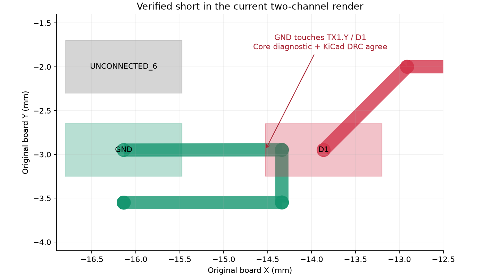

# Findings and evidence

## Single-ended: close agreement

Eye opening differs by 1.39 mV, approximately 0.14% of the nominal 1 V received swing. Loaded step delay differs by 0.60 ps. This is useful as a regression comparison. It is not an external accuracy reference.

Evidence: [common measurements](../data/cases/level1-single-ended/comparison.json), [native export validation](../data/cases/level1-single-ended/native-export-validation/results.json), [DRC](../data/cases/level1-single-ended/kicad-drc.json).

## Differential: timing disagreement and export fidelity

Pipeline delay is 426.43 ps, compared with Kisi’s 402.93 ps: a 23.50 ps gap. Eye heights differ by only 0.75 mV, showing why height alone misses this discrepancy. Increasing pipeline spatial refinement 2→4 changes delay by 0.046 ps.

A separate diagnostic moves the physical 120 Ω resistor to the RX reference while keeping the copper stubs. It increases the coarse-network gap from 23.45 to 36.47 ps. This control is not used in the main result and does not explain the discrepancy. Field/pad/stub, dispersion, and termination representations still need an independent reference before either tool can be assigned the error.

Kisi’s unmodified strict SPICE export validator returns **exit 1** for BUS_P. Maximum step response error is 5.18% for ladder and 5.21% for compact, exceeding its 5% limit. Compact Sdd21 differs by up to 3.41 dB over the full 10 GHz export band. Both exported models remain passive; their agreement with each other does not establish fidelity to the native analytic channel. The main plots use native Kisi Touchstone and therefore do not use the failed SPICE approximation.

Evidence: [common measurements](../data/cases/level1-differential/comparison.json), [strict exit status](../data/cases/level1-differential/native-export-validation-status.json), [validator report](../data/cases/level1-differential/native-export-validation.md), [full validator JSON](../data/cases/level1-differential/native-export-validation/results.json), [refinement audit](../provenance/refinement-results.json), [separate termination control](../data/cases/level1-differential/termination-location-control/control.json).

## Two channels: a physical short defeats the net-label simulation

**The current render connects D1 / TX1.Y to GND.** Core reports an accidental overlap before translation. KiCad independently reports two shorting contacts between U2 pad 4 and GND tracks. These are two contacts in one KiCad DRC run, not two independent KiCad runs.

Both SI extractors still produce plausible eyes because they treat declared nets as distinct. Kisi’s native D1 eye criterion is green. No healthy physical PCB result can be inferred from those eyes. A connectivity/shorts gate must precede interpretation of either extractor. The benchmark’s separate nonlinear IBIS run is blocked for this case.

Evidence: [core diagnostics](../data/cases/level2-two-channels/render-diagnostics.json), [independent KiCad DRC](../data/cases/level2-two-channels/kicad-drc.json), [Kisi native check](../data/cases/level2-two-channels/kisi-check.json), [IBIS gate](../data/cases/level2-two-channels/native-ibis-summary.json).

## Actions suggested by this experiment

1. Gate production SI results on physical connectivity/short checks.
2. Keep the BUS_P SPICE export unqualified until native-channel fidelity passes its strict validator.
3. Investigate the 23.50 ps native-channel gap against a measured or independent reference.
4. Use the valid single-ended board as a regression baseline while retaining the invalid case as a negative example.

The single-ended current render matches its historical accepted-board identity. The other two do not. These findings concern the pinned current renders, not an assertion that the historical accepted board had the same short. See [board identities](../provenance/board-source-identities.json).
